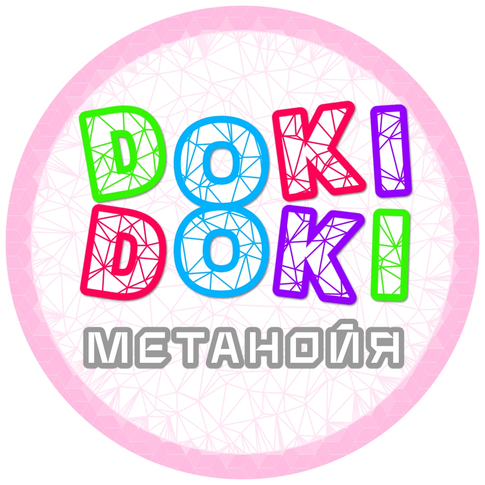

  

    
  

  <h1>Doki Doki Methanoia (DDM)</h1>
  

    
    
  

---

> [!CAUTION]
> Этот репозиторий является **единственным официальным источником** распространения версий данной модификации - **других нет**. Если Вам попадётся сторонний источник с моей модификацией (например, группы в Telegram), то **НЕ СКАЧИВАЙТЕ** его оттуда, поскольку я не гарантирую безопасность его файлов с такого источника.

---

> [!CAUTION]
> **ДИСКЛЕЙМЕР - ОБЯЗАТЕЛЬНО ПРОЧТИТЕ ДО КОНЦА**
>
> ДАННАЯ МОДИФИКАЦИЯ НИКАК НЕ СВЯЗАНА С Team Salvato И ЕЁ ПРОХОЖДЕНИЕ ДОЛЖНО ОСУЩЕСТВЛЯТЬСЯ ТОЛЬКО ПОСЛЕ ПРОХОЖДЕНИЯ ОФИЦИАЛЬНОЙ ИГРЫ. МОДИФИКАЦИЯ НЕ ПРЕДНАЗНАЧЕНА ДЛЯ ПРОХОЖДЕНИЯ ЛЮДЬМИ, НЕ ДОСТИГШИМИ 18 ЛЕТ, БЕРЕМЕННЫМИ ЖЕНЩИНАМИ ИЛИ ЛИЦАМИ, НАХОДЯЩИМИСЯ В СОСТОЯНИИ ЭМОЦИОНАЛЬНОГО СТРЕССА ИЛИ ИМЕЮЩИМИ ВЫСОКИЙ УРОВЕНЬ ВПЕЧАТЛИТЕЛЬНОСТИ, ПСИХИЧЕСКИЕ РАССТРОЙСТВА, СЕРДЕЧНО-СОСУДИСТЫЕ ЗАБОЛЕВАНИЯ ИЛИ ЭПИЛЕПСИЮ. ДАННОЕ ПРЕДУПРЕЖДЕНИЕ НЕ СОЗДАНО ЧИСТО «ДЛЯ ГАЛОЧКИ». ВАШЕ ЗДОРОВЬЕ ПРЕВЫШЕ ВАШЕГО ЖЕ ЛЮБОПЫТСТВА. НЕ ПРЕНЕБРЕГАЙТЕ ДАННЫМ ПРЕДУПРЕЖДЕНИЕМ. ЕСЛИ ВЫ ЯВЛЯЕТЕСЬ ЧЕЛОВЕКОМ В ЗОНЕ РИСКА, ТО НАЙДИТЕ В СЕБЕ СИЛУ ВОЛИ ПЕРЕБОРОТЬ СВОЁ ЖЕЛАНИЕ ИССЛЕДОВАТЬ МОДИФИКАЦИЮ. ВЫ - ВЗРОСЛЫЕ И САМОСТОЯТЕЛЬНЫЕ ЛЮДИ, И ДОЛЖНЫ ПРЕКРАСНО ОСОЗНАВАТЬ ДАННЫЕ РИСКИ. В ПРОТИВНОМ СЛУЧАЕ Я И ВСЕ, КТО ПРИЧАСТЕН К РАЗРАБОТКЕ ДАННОЙ МОДИФИКАЦИИ, НЕ НЕСЁМ НИКАКОЙ ОТВЕТСТВЕННОСТИ ЗА ТО, КАК ОНА ПОВЛИЯЕТ НА ВАШУ ЖИЗНЬ, НАСКОЛЬКО БЫ ГРОМКО НИ ЗВУЧАЛИ ДАННЫЕ СЛОВА. ОДНАКО МЫ РАССЧИТЫВАЕМ, ЧТО ВЫ ПОЛУЧИТЕ ПОЛЕЗНЫЙ ОПЫТ, КОТОРЫЙ ПОМОЖЕТ СТАТЬ ВАМ ЛУЧШЕ И ИЗМЕНИТЬ ВАШУ ЖИЗНЬ К ЛУЧШЕМУ. 

---

### Содержание:
1. [Завязка сюжета и количество его сегментов](#1-завязка-сюжета-и-количество-его-сегментов)
2. [Установка модификации](#2-установка-модификации)
3. [Сообщение о найденных ошибках](#3-сообщение-о-найденных-ошибках)
4. [Соцсети](#4-соцсети)
5. [Авторство и лицензии используемых материалов](#5-авторство-и-лицензии-используемых-материалов)
6. [Общие вопросы](#6-общие-вопросы)

---

### 1) Завязка сюжета и количество его сегментов

**Завязка сюжета:**
> Главный герой по имени Макс является 18-летним японским учеником старшей школы, проживающим в городе Мориока. В его жизни всё шло постоянно не так, как у других, начиная от специфического для Японии имени и заканчивая постоянными провалами завязать длительное общение с кем бы то ни было вне зависимости от количества вложенных в это сил. Он с этим смирился, и его жизнь стала идти своим чередом. В один момент родители купили бывший жилой дом по низкой цене в городе Ниигата и стали периодически туда приезжать, чтобы проводить в нём ремонт и обустройство для будущего самостоятельного проживания Макса. Сам он тоже принимал участие в таких поездках и помогал, как мог. И в одну из таких поездок Макс познакомился с Сайори - 17-летней ученицей старшей школы, которая жила буквально напротив его будущего дома. Она быстро нашла с ним общий язык, несмотря на свой энергичный характер. И вот, когда дом был полностью готов для проживания, а Макс закончил второй год обучения в старшей школе и его документы приняли в новой, он совершил переезд из Мориоки в Ниигату. От нового места Макс не ждал ничего особенного даже с учётом того, что Сайори стала его одноклассницей, с которой он каждый день шёл в школу и уходил обратно домой. Макс был уже готов смириться с учебной рутиной, лишь бы побыстрее выпуститься, но уже спустя неделю всё начинает рушиться одним ненавязчивым приглашением от Сайори в некий Литературный клуб, в котором она давно состоит, но про который практически ничего не рассказывала...

**Количество сегментов сюжета, доступные для прохождения на данный момент:** 
- Пролог (2 игровых дня);
- Акт 1 «Новая жизнь» (14 игровых дней).

> [!NOTE]
> Первая неделя Акта 1 может показаться скучной (потому что это начало, закладывающее основы сюжета), несмотря на мои попытки привнести разнообразие в повествование сюжета, но вторая неделя более динамичная и насыщенная событиями и новыми персонажами.

---

### 2) Установка модификации:

#### Если ваша операционная система (ОС) - Windows:
1. Скачать файл-установщик "Doki Doki Methanoia Installer.exe" актуальной версии модификации из вкладки [Releases](https://github.com/kitsurudev/DDM-releases/releases/) данного репозитория;
2. Запустить файл от имени администратора (если устанавливаете игру вне папки профиля пользователя) или от пользователя;
3. Следовать шагам установщика;
4. Для удаления модификации воспользуйтесь деинсталятором "unins000.exe", который будет находиться в директории модификации.

#### Если ваша операционная система (ОС) - не Windows или Вы решили сделать установку игры вручную:
1. Установить чистую версию "Doki Doki Literature Club" из магазина Steam или с официального сайта [ddlc.moe](https://ddlc.moe) **(не путать эту игру с Plus-версией) (русификатор на игру устанавливать не нужно)**;  
2. Скачать архив актуальной версии модификации из вкладки [releases](https://github.com/kitsurudev/DDM-releases/releases/) данного репозитория и установить распакованные файлы с заменой в корневую папку игры "Doki Doki Literature Club";
3. Для удобства можете удалить:
    - файлы "DDLC.exe", "DDLC.py", "DDLC.sh";
    - директории "characters", "DDLC.app".
    
    Все они не используются модификацией и никак не влияют на её работу.
4. Запустить игру через файл "DDM.exe";
5. Для полного удалении модификации удалите вручную директорию самой модификации и директорию сохранений с префиксом "DDM_" в названии. Она хранится по отдельному пути:
    - Windows: %AppData%/RenPy/
    - macOS: $HOME/Library/RenPy/
    - Linux: $HOME/.renpy/

---

### 3) Сообщение о найденных ошибках

Если Вы обнаружите какую-либо недоработку (например, проблема с отображением элементов, артефакты в изображениях/аудио) или критическую ошибку (движок RenPy выдаст специальный серый экран сообщения об ошибке), то сообщите о ней одним из способов:

1. Если у Вас есть аккаунт в GitHub (рекомендованный способ): 
    - в данном репозитории в разделе "Issues" создайте тему с описанием найденной Вами ошибки;

2. Если у Вас есть аккаунт в Discord:
    - перейдите на наш официальный сервер (ссылка-приглашение находится в разделе "Соцсети"), после чего перейдите в канал "репорт-ошибок" категории "Модификация Doki Doki Methanoia" и напишите там о найденной Вами ошибке.

По возможности я дам обратную связь и исправлю ошибку в будущих версиях модификации.  

> [!IMPORTANT]
> **Информация для стримеров и летcплееров** 
>
> Вся сторонняя музыка модификации (не из ресурсов оригинальной игры) без авторских прав (АП), все свободные лицензии (с рабочими гиперссылками) на их использование указаны в экстра-меню модификации в разделе "Музыка", который становится доступен после полного прохождения сюжета, поэтому музыку можно не заглушать из-за риска нарушения АП. 
> 
> Если Вы всё равно получите предупреждение о нарушении АП (маловероятно, но всё же), то сообщите об этом мне одним из способов, описанных в пунктах этого раздела, или в личных сообщениях Telegram или Discord (у меня установлено ограничение на общение только с теми людьми, кто состоит в общих со мной серверах и у кого нахожусь в друзьях) с **обязательным** подтверждением «официальности» вашего аккаунта (чтобы я понял, что это Вы, а не кто-то пытается выдать себя за Вас для обмана меня по какой-либо причине). Я постараюсь как можно раньше дать обратную связь и решить эту проблему.

---

### 4) Соцсети

Если Вы захотите следить за дальнейшей разработкой модификации и другими проектами команды «Orange Nova», то можете присоединиться к официальному серверу [Discord](https://discord.gg/H8EZ7YjjP7). 

> [!WARNING]
> В данный момент у команды нет других официальных ресурсов для взаимодействия с аудиторией. Если они появятся/изменятся текущие, то текст данного раздела будет обновлён.

---

### 5) Авторство и лицензии используемых материалов

Авторство и ссылки на источники ресурсов (музыка, спрайты персонажей, фоны, CG-сцены) и лицензии их использования указаны во всех соответствующих разделах экстра-меню модификации, которые становятся полностью доступными после прохождения сюжета.

> [!NOTE]
> Это не значит, что я пытаюсь скрыть чьё-то авторство или что я не ценю труд авторов - вовсе нет, потому что если бы не они, то этой модификации не было. Но поймите: если я начну перечислять всех авторов материалов и лицензии их использования прямо здесь, README станет километровым, а я превращусь в дыню. Поэтому считаю это бессмысленным занятием - в модификации данная информация уже предоставлена в удобном и интерактивном формате.

---

### 6) Общие вопросы

1. *Сколько времени занимает прохождение альфа-версии модификации?*  
    - *Приблизительно 7-8 часов минимум (при условии, что игрок не будет пропускать диалоги или читать их очень бегло). Поэтому пройти модификацию за «пару вечеров» с неторопливым чтением всех диалогов вряд ли получится.*

2. *В модификации есть разветвления в сюжете, как обычно бывает в визуальных новеллах?*  
    - *Нет, сюжет линеен, поэтому можете с головой погрузиться в прохождение.*

3. *Как воспринимать всё обозначение версии модификации?*  
    - *Следующим образом:*
      - *буква из греческого алфавита (alpha, beta, gamma и т.д.) - глобальная версия;*
      - *первый разряд числа - крупная версия в пределах глобальной (например, 1 - релиз, а любое прибавление единицы - крупное обновление - изменение/дополнение сюжета);*
      - *второй разряд числа - мелкое обновление (правки ошибок).*

4. *Почему модификация выложена здесь, а не на игровой площадке, например, в Steam?*  
    - *До 10 сентября 2025 года на официальном сайте [Team Salvato](https://teamsalvato.com/) в разделе "IP Guidelines" это не было указано явно. После - разрешено на таких площадках, как itch.io (Steam не относится) (с определёнными ограничениями). Но учитывая, что у модификации нет поддержки английского языка (его трудно реализовать из-за большого количества отсылок, объёма текста и прочих причин) и что мне проще контролировать репозиторий GitHub, я решил ограничиться данным репозиторием, к тому же популярность от таких площадок существенно не повлияет на охват аудитории. В любом случае данная модификация никогда не станет полноценной независимой игрой, у которой будет нормальная и достойная реклама, к сожалению.*

5. *Можно ли как-то финансово поддержать разработчика и его команду пожертвованием?*  
    - *Пока что мы не реализовали никакой системы пожертвования. Если на него будет большой спрос, то мы обязательно займёмся данной системой. Как только она будет готова, данный текст будет обновлён.*